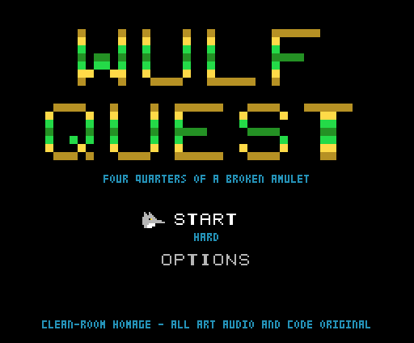
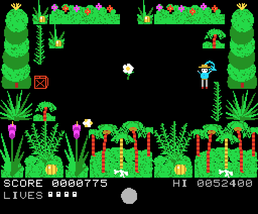
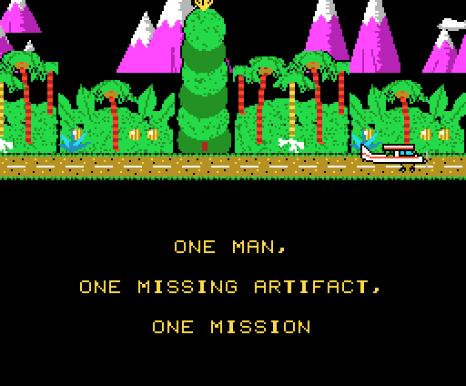
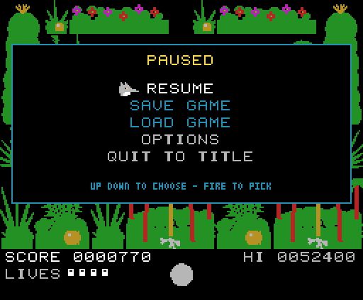
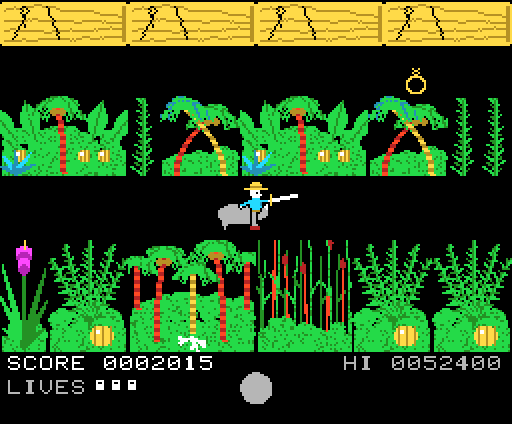
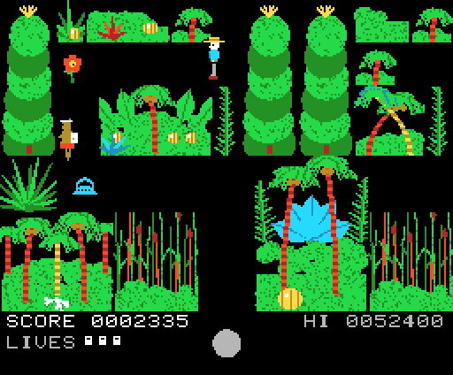
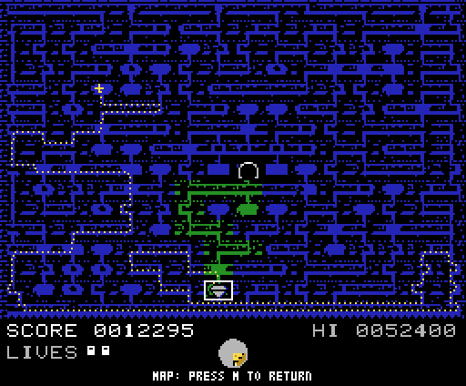

# Wulf Quest for MSX2

**Homepage: https://boaglio.github.io/wulfquest-msx/**, to play it in your
browser or download it.

[Wulf Quest](https://github.com/boaglio/wulfquest) is a flip-screen jungle
adventure: Ranger Vale alone in a 256-room jungle, looking for the four
pieces of a broken amulet, with the Wulf on his trail. This is its version
for the MSX2, as a ROM cartridge, played the same way as the original, tick
for tick.

<p>


</p>
<p>


</p>
<p>


</p>
<p>

</p>

It is a pre-release: the whole game is in, and its tuning for real machines
is still going on (the busiest rooms can run a little slow).

## What it needs

An **MSX2**, an MSX2+ or a turbo R, 50 Hz or 60 Hz (the game runs at the
same speed on both). On an MSX1 it says so.

## Getting it

- **In the browser:** the [homepage](https://boaglio.github.io/wulfquest-msx/)
  runs it in [WebMSX](https://webmsx.org/), as a European (50 Hz) or a
  Japanese (60 Hz) MSX2.
- **The files:** the homepage has the latest build; the
  [releases](https://github.com/boaglio/wulfquest-msx/releases) have tagged
  versions, each with:
  - `wulfquest.rom`, a 512 KB **ASCII16** MegaROM;
  - `wulfquest-saves.dsk`, a blank 720 KB disk for the saves;
  - `SHA256SUMS`, and screenshots.

## Playing it

- **openMSX** (it brings C-BIOS, a free BIOS, so no system ROM is needed):

  ```bash
  openmsx -machine C-BIOS_MSX2_EU -carta wulfquest.rom -romtype ASCII16
  ```

  `C-BIOS_MSX2_JP` is a 60 Hz machine. To save, use a real MSX2 machine
  with a disk drive in openMSX (C-BIOS's has no disk ROM), with
  `-diska wulfquest-saves.dsk`.
- **Other emulators** (blueMSX, fMSX, ...): load the ROM as a cartridge on an
  MSX2 and choose the ASCII16 mapper if asked.
- **A real MSX2:** write the ROM to a flash cartridge that can be a 512 KB
  ASCII16 MegaROM (a MegaFlashROM SCC+, a Carnivore2, ...); saves need a
  disk drive and a disk (the blank one, or any MSX-DOS disk).

## Controls

| | |
|---|---|
| Walk | cursor keys (or `Q` `A` `O` `P`, in the options), or a joystick |
| Swing the sabre | `Space` or fire |
| Map | `M` or the second button |
| Pause | `STOP` or `F1` |
| Back a step | `ESC` |

## Saves

Three slots on a disk in the machine's drive: saved every minute and from
the pause menu; the last game is offered first on the title (`CONTINUE`).
Without a disk drive the game plays the same, without saves. The hi-scores
are kept with the saves.

## Building it

How to build it and run its tests is in [DEVELOPER.md](DEVELOPER.md); how it
was made, milestone by milestone, in [AGENTS.md](AGENTS.md).

## Credits and attribution

Wulf Quest is an independent, clean-room homage to the flip-screen jungle
maze genre of the early 1980s. All artwork, audio, and code are original.
Room layout geometry was reconstructed from publicly documented map data.
No assets from any commercial game are included. Not affiliated with,
endorsed by, or derived from the code of any prior work.

Built with [MSXgl](https://github.com/aoineko-fr/MSXgl), the MSX game
library by Guillaume "Aoineko" Blanchard (CC BY-SA 4.0).

## Licence

Wulf Quest for MSX2 is free software: you can redistribute it and/or modify
it under the terms of the GNU General Public License as published by the
Free Software Foundation, either version 3 of the License, or (at your
option) any later version. It is distributed in the hope that it will be
useful, but WITHOUT ANY WARRANTY; without even the implied warranty of
MERCHANTABILITY or FITNESS FOR A PARTICULAR PURPOSE. See the GNU General
Public License for more details.
